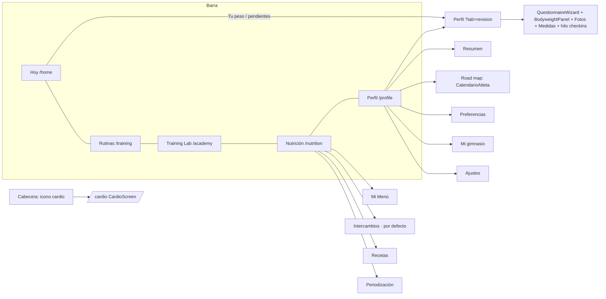

# 01 · Arquitectura actual

> Referencia: `origin/main` (be2fe73). Solo lo comprobado en código.

## Stack y ejecución

- React 19 + TypeScript + Vite 6 + Tailwind 4 (`@theme` en `src/index.css`), react-router 7, TanStack Query (persistido), Recharts, Sentry.
- Firebase: Auth, **Firestore con base nombrada** (`ai-studio-b38fc63b-…`), Storage. Funciones serverless en `api/` (Vercel). Asistente con `@anthropic-ai/sdk`.
- Capacitor 8 (iOS/Android) con `webDir: dist` empotrado; plugins: bluetooth-le, app, haptics, local-notifications, capacitor-health. **Los atletas usan sobre todo la web de Vercel en el móvil.**
- Local: `npm run dev` → Vite en **3000** (el `.claude/launch.json` del Escritorio arranca `en-forma-dev` en 5175). Bancos sin sesión: `/ui`, `/dev/revision`, `/dev/revision-coach`, `/dev/calendario`, `/dev/calendario-atleta`, `/dev/asignados`, `/dev/cardio-live`, `/dev/cardio-mini-player`, `/dev/gimnasio`, `/dev/recetario`, `/dev/progresion`, `/dev/plantilla`, `/dev/orden-ciclo`, `/dev/onboarding`, `/dev/legal` (`App.tsx:719-843`).
- Tests: Vitest (`npm test`), reglas con emulador (`npm run test:reglas`). Sin Playwright en el proyecto.

## Mapa de navegación del atleta (actual)

Redirecciones: `/checkin` → `/profile?tab=revision`; `/roadmap` → `/profile?tab=roadmap` (`App.tsx:1154`).

## Coach (actual)

- `ClientHub.tsx` (hub por atleta): Revisiones, Entrenamientos, Dietas, Ficha, Roadmap, Cardio, Notas…
- Mesociclo (`MesocycleManager.tsx`): pestañas **Volumen · Draft · Distribución · Ejercicios · Seguimiento CDG · Cierre** (`:3525`). Dentro de Ejercicios: `BarraDeSemanas`, hoja «Progresiones en un clic» (`:1248`), «Planificar progresión», `PanelIndicesCdg`, `ResumenCdgDia`.
- Nutrición (`NutritionCoachScreen`): Dietas / Alimentos / Recetas; por atleta `ClientDietsPanel` embebe `NutritionPlansScreen`, `WeeklyMenuEditor`, `ReglasDeRecetasPanel`, `NutritionPeriodizationPanel`.
- Biblioteca: ejercicios (`ExerciseLibraryScreen`, `ExerciseTriageScreen`), Academia (`AcademyCoachScreen`, `/library/academia`), cuestionarios (`QuestionnaireManagerScreen`, `QuestionnaireEditor`).
- CRM (`src/features/crm/`): Dashboard, Pagos, Renovaciones, Reuniones.

## Datos (colecciones relevantes para el plan)

Clave de atleta = **email** en todas (migración 24-08). Coach único fijado por email en `firestore.rules` (`isCoach`).

| Dominio | Colecciones | Notas |
|---|---|---|
| Objetivos nutrición | `onboarding/{email}` (`targetCalories`, `macroGrams`), `diets.budget`, `nutritionPrograms/{email}` (fases, `targetKcal`), `athleteDietConfigs/{email}` (`activeDietIds`, `weeklySchedule`) | 4 fuentes, ver 05 §1 |
| Config nutrición | `athleteNutritionConfigs/{email}` (`enabledModes`, `mealCount`, `cookingMaxTime`…) | sin kcal |
| Alimentos | `foodItems` (311, seed `src/nutricion_seed_en_forma.ts`), `alimentosPersonales/{email}` | `MealItem.label` con gramos en texto |
| Dietas / menús | `diets`, `weeklyMenus`, `dietCompletionLogs/{email}_{fecha}`, `menuCompletionLogs` | |
| Recetas | `recipes` (`ownerId` `'recetas'`/`'indya'`/uid), `public/recetas-indice.json` (4,97 MB), `athleteRecipeRules/{email}`, `recipeFavorites` | |
| Entreno | `exercises`, `workouts`, `mesocycles` (`ejerciciosClave`, `draftMaquinas`), `mesocycleTemplates`, `workoutAssignments`, `workoutLogs`, `exerciseNotes`, `repartosGuardados` | |
| CDG | `cdgCatalogo/v4` (Firestore), `Exercise.cdgNombre` | |
| Seguimiento | `bodyweightLogs`, `bodyMeasurements`, `progressPhotos`, `photoAssignments`, `questionnaires`, `questionnairePacks`, `questionnaireAssignments`, `questionnaireResponses`, `checkins` (legado) | |
| Cardio | `cardioSessions`, `cardioAssignments`, `hrTests`, `hrvReadings` | |
| Academia | `academyCourses`, `academyLessons`, progreso, `academyAccess` | |
| CRM | `crmClientes`, `crmServicios`, `crmPagos`, (`crmSuscripcion` obsoleta) | importes en céntimos |

## Componentes compartidos coach ↔ atleta

`ui/*` (Sheet, Dialog, Tabs, SegmentedControl, PageHeader, StatTile, WeightWheelPicker), `ProgressRing`, `BodyweightPanel`, `QuestionnaireWizard`, `CheckInScreen` (atleta) ↔ `ClientReviewsPanel`/`AssignedQuestionnairesPanel` (coach), `DietMealsView`, motores puros en `src/utils/` (todos con tests).

## Flujos coach → atleta (comprobados)

- **Dieta**: coach crea `Diet` con `athleteId` → activa o programa por día (`athleteDietConfigs`) → el cliente del atleta reescribe `activeDietIds` según la fase activa (`NutritionScreen.tsx:514`) → `dietaPautadaDelDia` elige `weeklySchedule[día]` antes que `activeDietIds` (`utils/nutritionSummary.ts:37`) → `dietaDeLaSemana` aplica ajustes por semana.
- **Menú semanal**: `WeeklyMenuEditor` genera (menuEngine) → borrador → `publishWeeklyMenu`. Automático: `services/menuSemanalAutomatico.ts` se lanza al abrir el **Inicio del coach** (no hay servidor).
- **Cuestionarios**: asignación con cadencia → ocurrencia forzada a viernes, pendiente hasta el martes → respuesta = un `addDoc` → completado se deduce por existencia de respuesta en la ventana.
- **Mesociclo**: plantilla/creación → `Workout.dayIndex`, `workoutAssignments` → sesión del atleta resuelve la semana con `resolverEjercicioDelMeso` (`progression.ts`) → `workoutLogs`.
