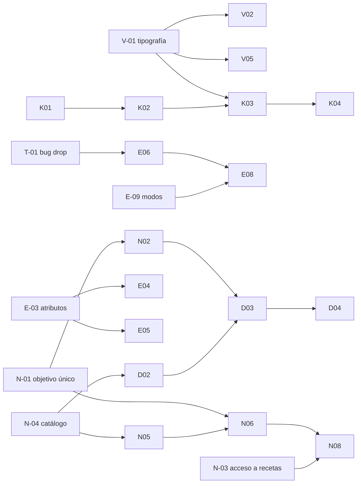

# 02 · Plan priorizado (backlog maestro)

> Complejidad relativa: **S** (horas, 1-3 archivos) · **M** (1-2 días, varias capas) · **L** (varios días, modelo de datos o migración) · **XL** (motor nuevo o migración global). Lo que más la hace variar: datos reales que no cuadran con el código, migraciones en producción y QA en móvil.
> Tipo: **BUG** error funcional · **VIS** mejora visual · **NUEVA** funcionalidad · **REF** refactor necesario · **DEC** pendiente de decisión.
> Prioridad: **P0** bloquea o corrompe datos · **P1** prioridad de negocio · **P2** mejora importante · **P3** cuando haya hueco.

## Orden de fases (y por qué cambia respecto al documento original)

| Fase | Contenido | Cambio vs. propuesta inicial |
|---|---|---|
| **1 · Fundamentos y errores críticos** | Tipografía/tokens, pestañas, cabecera, calendario fuera, peso rápido, cardio libre, **bug del drop set**, borradores visibles al atleta | El bug de técnicas sube aquí desde la fase 3: hoy **registra datos erróneos** (volumen, IEA). |
| **2 · Nutrición** | Fuente única de objetivos → Intercambios+Diario a la vez → acceso a recetas (todos/grupo/atleta) → catálogo estructurado → recetas con ingredientes → motor de ajuste → panel de recetas | La **fuente única de objetivos** va primero: sin ella, el diario de la fase 4 nace contradiciéndose con intercambios. |
| **3 · Entrenamiento** | Volumen+IEM/IF, nombres compactos, atributos y filtros, clasificación global, panel de ejercicio, modelo serie+técnica completo, progresiones por IEM, modos semanales, carga aguda/crónica | Igual. |
| **4 · Diario tipo MyFitnessPal** | Fuentes y licencias → modelo de registro → búsqueda → escáner | Depende de N-01, N-02 y N-04. |
| **5 · Check-ins** | Motor de revisión semanal, progreso en servidor, wizard nuevo, Perfil › Revisión de consulta | Podría adelantarse a la 4 si se quiere un resultado visible antes: es independiente de nutrición. |
| **6 · CRM y Training Lab** | Catálogo de servicios, migración de nombres, ingresos por servicio; documentar Training Lab | Igual. |

La navegación con botón central (V-05) va en la fase 1 pero enlaza Check-ins a Perfil › Revisión hasta que exista K-01.

---

## Orden de ejecución por modelo (decidido por Dani, 22-oct)

**Primero todo lo que se hace con Sonnet; lo que pide Opus se deja para el final.**

| Bloque | Tareas | Modelo |
|---|---|---|
| **A · Sonnet** (primero) | Resto de la fase 1 (hecho: V-01…V-05, P-01, C-01, C-02, T-01, N-00) · **N-01** objetivo único (función pura + tests) · N-02 · N-03 acceso a recetas · N-08 panel de recetas · E-01 volumen con IEM/IF · E-02 cabeceras compactas · E-03 atributos y filtros (script en seco) · E-04 clasificación global · E-05 ficha de ejercicio · E-07 limpiar progresiones · D-01…D-05 diario y escáner · K-01…K-05 check-ins · R-01…R-03 CRM · L-01 | Sonnet |
| **B · Opus** (al final, en este orden) | **N-04** catálogo de alimentos con macros (migración de 311 docs) → **N-05** recetas con ingredientes vinculados → **N-06** motor de ajuste de recetas · **E-06** modelo serie + técnica (migración) → **E-09** modos estático/dinámico → **E-08** progresión por IEM → **E-10** carga aguda/crónica · decisión E-11 | Opus |

Notas: el diario (D-*) arranca en el bloque A con alimentos personales + Open Food Facts + gramos de intercambio del banco actual; los datos por 100 g del banco propio llegan con N-04. Antes de empezar el bloque B se propone cambiar de modelo (`/model`) y abrir sesión nueva leyendo `estado-actual.md`.

---

## Fase 1 · Fundamentos visuales y errores críticos

**V-01 · Escala tipográfica y tinta** — VIS · P1 · M
- Problema: 2.043 usos de 11 px; subtítulos a 13 px; preguntas a 11 px en mayúsculas.
- Pantallas: todas. Archivos: `src/index.css` (`--text-*`, `--p-ink-*`), `ui/PageHeader.tsx:90`.
- Cambio: body 16, body-s 14, label 13, caption 12 (suelo); ink-2/3/4 sólidos (ver 03 §2). Oscuro: subir alfas.
- Depende de: nada. Riesgo: desbordes en tablas densas del coach → revisar `BarraDeSemanas`, `PanelIndicesCdg`, CRM.
- Aceptación: ningún texto < 12 px en móvil; ink-3 ≥ 7:1 claro y ≥ 7:1 oscuro; sin cortes a 360 px.
- Comprobar: `grep text-\[(8|9|10|10.5)px\]` = 0; capturas de los 15 bancos `/dev/*` en claro y oscuro a 375 px.

**V-02 · Pestañas segmentadas (Nutrición, Perfil, coach)** — VIS · P1 · S
- Problema: inactiva gris sobre crema; en oscuro ≈2,4:1. Archivo: `ui/Tabs.tsx:100-102`.
- Cambio: variante «segmentada» (carril `inset`, activa en superficie + 800) para ≤4 pestañas; píldoras para Perfil. Depende: V-01.
- Aceptación: inactiva ≥ 4,5:1 en ambos modos; estado activo distinguible sin color (peso + fondo).

**V-03 · Cabecera adaptativa** — VIS · P2 · S
- `App.tsx:1018-1072`, `ui/AtlasLogo.tsx`. Wordmark con «Forma» en `accent-ink`; variante blanca solo sobre superficies `veil` (portadas oscuras, sesión en vivo). Quitar icono de cardio (pasa a V-05).
- Aceptación: nunca texto blanco sobre fondo claro (comprobación por superficie, no por modo).

**V-04 · Retirar el calendario del Perfil** — REF · P2 · S
- Quitar `CalendarioAtleta` de `AthleteRoadmapScreen.tsx:306` y los componentes solo suyos (`roadmap/calendario/atleta/*`: `MesAtleta`, `SemanaAtleta`, `SheetDiaAtleta`) y el banco `/dev/calendario-atleta`.
- **Conservar** `utils/roadmapCalendar.ts` y `NivelAno` (los usa el calendario del coach `RoadmapCalendario.tsx`).
- Aceptación: Roadmap del atleta sigue mostrando fases/hitos; calendario del coach intacto; tests verdes.

**V-05 · Barra con botón central + hoja de herramientas** — NUEVA · P1 · M
- Barra Hoy · Rutinas · [+] · Nutrición · Perfil. Hoja con Cardio, Check-ins (con contador), Training Lab (atenuada sin acceso). Reutiliza `ui/Sheet.tsx`. Archivos: `App.tsx:209-213, ~1250-1310`.
- Depende: V-01. Riesgo: memoria muscular de los atletas → aviso en Novedades (`data/novedades.ts`).
- Aceptación: 1 toque abre, 1 toque cierra; Escape/arrastre cierran; foco atrapado; rutas `/academy`, `/cardio` siguen funcionando por URL.

**P-01 · Registro rápido de peso desde Inicio** — NUEVA · P1 · M
- Hoja sobre Inicio con último peso, `WeightWheelPicker`, guardar, confirmación y refresco de `useAthleteWeight`.
- **Id determinista `{email}_{YYYY-MM-DD}`** en `bodyweightLogs` (hoy `addDoc`): re-guardar sustituye. Ajustar `BodyweightPanel.tsx:128` y `QuestionnaireWizard.tsx:184` para usar la misma función.
- Depende: nada (regla Firestore: comprobar que permite `set` con ese id). Riesgo: históricos con varios pesos el mismo día → la lectura toma el último; no se migra nada.
- Aceptación: guardar dos veces el mismo día = 1 documento; Inicio muestra el nuevo valor sin recargar; edición desde Perfil › Revisión.

**C-01 · Cardio libre siempre disponible** — BUG · P1 · S
- `CardioScreen.tsx:244-249`: sin `cardioProfile` no se pinta `CardioToday` ni «Ya lo hice». Mostrar siempre «Empezar ahora» (cronómetro + RPE en web; BLE en nativo) y «Ya lo hice».
- Aceptación: atleta sin zonas ni pauta puede iniciar, terminar y ver la sesión en el historial (`cardioSessions`, tipo `libre`).

**C-02 · «Mover a mañana» real** — BUG · P2 · M
- Hoy solo localStorage (`utils/cardioSkipToday.ts`). Mover la fecha de la `cardioAssignment` (o crear excepción por fecha) con deshacer; visible al coach.
- DEC: ¿el atleta puede mover siempre o solo si el coach lo permite? (ver 06).

**T-01 · Drop set / myo / rest-pause no sustituyen series** — BUG · **P0** · L
- Causa: técnica por ejercicio (`types.ts WorkoutExercise.technique`) + `DropsetRows` marca fila 0 BASE y resto D1/D2 (`ExerciseCard.tsx:76, :438-449`); bajadas guardadas como series.
- Arreglo en dos pasos: (a) **inmediato**: si `technique` está a nivel de ejercicio, interpretarla como «en la última serie» (coherente con `utils/cdg/adaptadores.ts`) y pintar N series + segmentos; segmentos guardados con `segmentoDe` y excluidos del volumen. (b) modelo por serie en E-06.
- Riesgo: logs históricos con D1/D2 contados como series → decidir si se recalculan (06).
- Aceptación: 3 series + drop en S3 ⇒ el atleta ve 3 filas + 2 segmentos; volumen = 3 series; IEA/IEM no cuentan segmentos como series. Test nuevo de `ExerciseCard`/`setPrefill`.

**N-00 · Borradores de dieta visibles al atleta** — BUG · P1 · S
- `isDraft` no se filtra en `dietaPautadaDelDia` ni en `NutritionScreen.tsx:343` [S: sucede si se activa/programa un borrador]. Filtrar y avisar al coach si programa un borrador.

---

## Fase 2 · Nutrición (prioridad de negocio 1)

**N-01 · Fuente única de objetivos (`NutritionTargets`)** — REF · **P0** · L
- Problema: `onboarding.macroGrams`, `Diet.budget`, `phase.targetKcal`, `weeklySchedule` pueden contradecirse.
- Propuesta (05 §1): el objetivo del día se **resuelve** en una función pura `objetivoDelDia(email, fecha)` a partir de la fase activa; `onboarding` solo semilla; `Diet.budget` deriva o se valida contra el objetivo. Unificar `G_PER_EXCH` (`NutritionPlansScreen.tsx:65`) con `GRAMS_PER_EXCHANGE` y el trato de MIX en `exchangeToKcal`/`kcalDeDieta`.
- Depende: nada. Bloquea: N-02, N-06, D-*. Aceptación: un cambio de kcal/macros del coach se ve igual en Intercambios, Mi menú y (futuro) Diario; test de paridad `objetivoDelDia` vs. budget.

**N-02 · Intercambios y Diario disponibles a la vez** — NUEVA · P1 · M
- El atleta puede usar **los dos**: pestañas «Mi menú · Intercambios · Diario · Recetas». No hay campo de «metodología» obligatorio por atleta. Comparten N-01 (mismo objetivo) y las recetas.
- DEC (D3): ¿quieres poder ocultar el Diario a un atleta concreto? Si sí, es un interruptor opcional, por defecto activado.

**N-03 · Acceso a recetas: todos / grupo / atleta** — NUEVA · P1 · L
- Las **dietas de kcal siguen siendo individuales** (como hoy). Lo que se gestiona globalmente son las **recetas**: qué recetas ve cada atleta.
- Dos niveles: **base** (sencillas, las «Rápidas» y nuevas básicas) y **ampliada** (más variedad). Por defecto todos ven la base; el coach concede la ampliada a todos, a un grupo o a un atleta.
- Prioridad: **atleta > grupo > todos**. Se apoya en `athleteRecipeRules/{email}` (ya esconde recetas por atleta y ámbito: menú, cambios, recetario) + un documento global y grupos reutilizables. Cambiar el alcance global no pisa las reglas individuales: muestra a quién afecta antes de confirmar.
- Incluye etiquetas para filtrar (tiempo, tipo de comida, ingredientes, restricciones; ya en `poolDelAtleta.ts`).

**N-04 · Catálogo de alimentos estructurado** — REF · P1 · L
- Añadir a cada `foodItems`: `porCien {kcal,p,hc,g}`, `estado: crudo|cocido|seco|escurrido`, `unidad`, `fuente` (BEDCA/etiqueta/propio), sin romper `label`. Migración con script en seco → revisión → aplicar (311 docs). `escalarIngrediente.ts` deja de depender del texto.
- DEC: fuente de los valores por 100 g (BEDCA requiere autorización para uso comercial, ver 05 §4).

**N-05 · Recetas base con ingredientes vinculados** — NUEVA · P1 · L
- Rehacer las 79 «Rápidas» (y las nuevas: arroz con tomate y pollo, pasta con carne, pizza controlable, hamburguesa…) como `ingredientes[{foodId, gramos, min, max, palanca}]`; macros = suma del catálogo. Las 8.850 importadas siguen como «biblioteca ampliada» con sus macros.
- Aceptación: kcal de la receta = Σ ingredientes ± redondeo; cambiar un alimento del catálogo recalcula.

**N-06 · Motor de ajuste de recetas a objetivo** — NUEVA · P1 · XL
- Determinista (05 §3): resolver cantidades por ingrediente-palanca dentro de rangos para acercarse a P/HC/G de la comida; si el error > tolerancia, decir «no encaja» y proponer alternativa (reusar `menuEngine.rankCandidates`). Reutiliza ideas de `bestScaleFit` y `escalarRecetaEntera`.
- Aceptación: casos de prueba con objetivos fijos y salida reproducible; nunca fuera de rangos; explica qué cambió.

**N-07 · (fusionada con N-03)** — la biblioteca base/ampliada y el acceso por alcance son la misma tarea.

**N-08 · Panel del coach «Recetas»** — NUEVA · P1 · L — lámina 07: lista filtrable de recetas con nivel y alcance, acceso por grupo/atleta y editor de receta con prueba de ajuste. Sin plantillas de dieta.

**N-09 · Trazabilidad de cambios nutricionales** — NUEVA · P3 · M — historial (quién, cuándo, antes/después) en plantillas y recetas base.
  - **HECHO (23-oct), alcance A de Dani:** dietas, programa, calendario y configuración ya dejaban historial (`cambiosAtleta`); se añadieron las reglas de recetas por atleta (ocultas, alcance, recomendadas, lista del menú, recetario) con `resumirReglasDeReceta` (`utils/cambiosAtleta.ts`) y `saveReglasDeReceta` (`db/recipes.ts`, lee el «antes» con un `getDoc` del atleta). Sin colección ni regla nuevas. La lista global del menú NO deja historial (opción B descartada); las recetas base se editan por script y ya quedan en git.

---

## Fase 3 · Entrenamiento (prioridad de negocio 2)

**E-01 · Volumen con IEM e IF y resumen semanal plegable** — VIS/NUEVA · P1 · L
- Unir `ProgressionView` (series) y `PanelIndicesCdg` (IEM/IF) en una vista: tarjetas de resumen semanal arriba; detalle por zona plegable; IF y estrés articular plegados. Lámina 11.
- Aceptación: resumen legible sin desplegar; detalle accesible; números a ≥ 14 px; no confunde valor de ejercicio con total de semana (etiquetas explícitas).

**E-02 · Cabeceras de sesión compactas** — VIS · P2 · S
- `nombreDeSesion` (`nombresMeso.ts:41`) produce «Torso · Javier Vergara · Meso #1». En tablas usar nombre corto (`Torso A`) + día; tooltip/detalle con el completo. `PanelIndicesCdg.tsx:199`.

**E-03 · Atributos del ejercicio + filtros rápidos** — REF/NUEVA · P1 · L
- Añadir `equipment[]` (normalizado), `lateralidad: uni|bi`, `goma: bool`, `guiado: bool`; rellenar con script (heurística por nombre + catálogo CDG `category/subcategory` + `draftMaquinas`) y revisión en Triage. Filtros solo cuando la cobertura ≥ 90 %.
- Aceptación: ningún filtro visible sin datos detrás; Draft filtra por material del gimnasio del atleta.

**E-04 · Corregir clasificación global desde la planificación** — NUEVA · P1 · M
- Abrir ficha desde Draft/Ejercicios; editar principal **y secundarios**; vista previa (atletas y mesos afectados); confirmación; registro en `exerciseChanges`; regla Firestore solo coach. Prescripciones guardadas no cambian; los cálculos de volumen se recalculan al leer.

**E-05 · Panel de índices por ejercicio** — VIS · P2 · M — ficha con IEM por músculo (barras), IF, estrés articular, «valores por serie». Lámina 12.

**E-06 · Modelo serie principal + técnica** — REF · P1 · L
- `WorkoutSetGroup`/prescripción por serie con `tecnica?: {tipo, params}`; `WorkoutSetLog.segmentoDe?`. Parámetros por técnica (05 §6). Migración: técnica a nivel ejercicio ⇒ «última serie». Depende: T-01.

**E-07 · Limpiar «Progresiones en un clic»** — REF · P1 · M
- Retirar descanso y «Series de alta intensidad» y la aplicación a todo el bloque (`MesocycleManager.tsx:1248-1470`, `semanasDelBloque.ts:85-163`). Conservar «RIR semana a semana», subir series y reps dentro de «Planificar progresión» con selección explícita.
- Comprobar antes: `restSeconds`/`technique` en `CambiosDeSemana` siguen leyéndose para lo ya programado.

**E-08 · Progresión por objetivo de IEM** — NUEVA · P1 · XL
- Motor determinista (05 §7): por ejercicio/zona seleccionados, propone series/RIR/técnica para llegar al IEM objetivo usando el motor CDG; explica; el coach aprueba casilla a casilla. Lámina 13.

**E-09 · Modos estático/dinámico × suave/medio/agresivo, evaluación semanal** — NUEVA · P1 · L
- Unificar con `utils/cdg/agujetas.ts` (rama IH). **DEC**: 2 o 3 niveles de sensibilidad (Excel dice estático/medio/dinámico). Ventana de 7 días. Umbrales configurables y marcados «pendiente de validar».

**E-10 · Carga aguda/crónica de sesión, semana y mesociclo** — NUEVA · P2 · L
- Hoy `utils/cdg/seguimiento.ts` exige 6 semanas exactas del bloque. Propuesta: crónica = EWMA o media de las últimas N semanas **cruzando bloques** (05 §8). Avisos al coach.

**E-11 · IEA acumulado invertido** — DEC · P2 · S — `accumulatedStimulusIndex.ts` premia RIR alto; decidir si se retira en favor del IEM CDG o se corrige.

---

## Fase 4 · Diario de alimentos (tipo MyFitnessPal)

**D-01 · Decisión de fuentes y licencias** — DEC · P1 · S — 05 §4. Recomendado: banco propio + Open Food Facts (ODbL, caché por código) + alimentos del atleta.
**D-02 · Modelo `foodLog`** — NUEVA · P1 · M — entradas por atleta/fecha/comida con instantánea de nutrientes y fuente.
**D-03 · Pantalla de diario + búsqueda** — NUEVA · P1 · L — lámina 05; reutiliza `utils/busqueda.ts`, `CrearAlimentoSheet`.
**D-04 · Escáner** — NUEVA · P2 · L — web: ZXing WASM (Safari iOS no tiene `BarcodeDetector`); nativo: plugin ML Kit; texto de permiso de cámara. Lámina 06.
**D-05 · Productos ausentes o incompletos** — NUEVA · P2 · S — marcar «datos incompletos», no inventar; crear desde etiqueta.

## Fase 5 · Check-ins

**K-01 · Motor de «revisión de la semana»** — REF · P1 · M — función pura que agrupa asignaciones vencidas (reglas de `questionnaireSchedule.ts` sin cambiarlas) + peso + fotos en una revisión con pasos.
**K-02 · Progreso en servidor** — NUEVA · P1 · M — `questionnaireResponses` con `estado: borrador|enviada` (o doc de progreso por revisión); completa = obligatorios enviados.
**K-03 · Wizard rediseñado** — VIS · P1 · M — una pregunta por pantalla para escalas/abiertas; agrupar métricas sencillas. Lámina 08.
**K-04 · Perfil › Revisión = consulta** — REF · P2 · S — mismo motor; historial y estado. Lámina 09.
**K-05 · `checkins` legado** — DEC · P2 · S — el contador del coach (`usePendingReviews`) cuenta `checkins` que ya no se crean → pasar a contar revisiones K-01.

## Fase 6 · CRM y Training Lab

**R-01 · Catálogo de servicios** — NUEVA · P2 · S — `tipoServicio: trimestral|semestral|anual` (+ «otro» controlado); `nombre` derivado.
**R-02 · Normalizar nombres existentes** — REF · P2 · M — script en seco con tabla «texto actual → tipo», revisión de Dani, aplicar. No toca importes ni fechas.
**R-03 · Ingresos por servicio** — NUEVA · P3 · M — cobrado neto (pagado − devoluciones) por tipo y periodo; ticket medio; tasa de renovación. «Rentabilidad» real requiere costes/comisiones (no existen).
**L-01 · Documentar Training Lab** — DOC · P3 · S — cómo se crea, publica, asigna y desbloquea (ya existe, ver 00).

---

## Dependencias críticas

