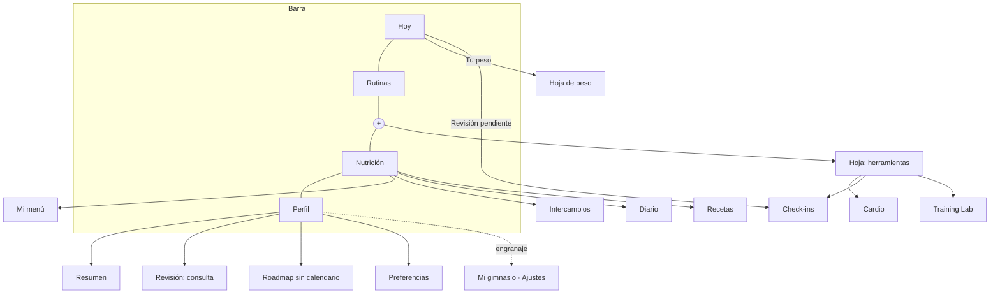
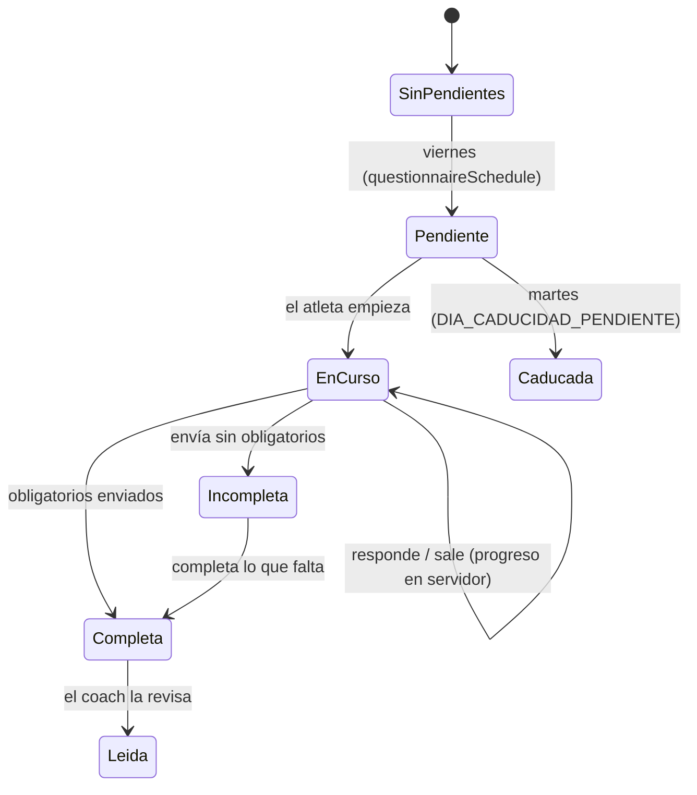
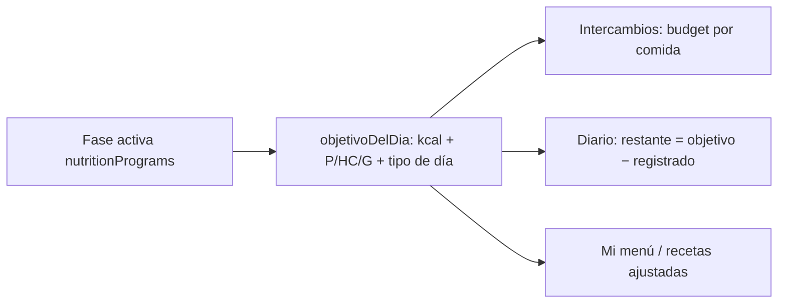

# 04 · Flujos funcionales propuestos

## 1. Navegación del atleta (propuesta)

«Periodización» de Nutrición pasa a un acceso desde la fecha/objetivo del día (hoy es la 4ª pestaña; se valida con Dani, ver 06).

## 2. Peso rápido (P-01)

1. Inicio › «Registrar hoy» → hoja con último peso y selector.
2. Guardar → `setDoc(bodyweightLogs/{email}_{fecha})` (sustituye si existe) → toast «Peso de hoy guardado» → invalidar `['bodyweightForAthlete', email]`.
3. Si ya hay peso hoy: la hoja abre en modo «Corregir» con el valor actual.
4. Historial y borrado: Perfil › Revisión (ya existe en `BodyweightPanel`).
5. El check-in semanal usa el mismo componente en su paso 1.

## 3. Check-ins (K-01…K-04)

- **Qué toca**: lo deciden las asignaciones actuales (`questionnaireAssignments` + cadencia + `overrides`) y `photoAssignments`; no se cambian reglas.
- **Orden**: peso (si algún cuestionario de la revisión tiene `metric: bodyweight` o hay foto/peso asignado) → cuestionarios por orden de paquete → fotos → resumen.
- **Formato por tipo**: `scale` y `choice` una por pantalla; `numeric`/`metric` sencillas agrupadas (máx. 3); `text` una por pantalla con teclado; `media` paso propio.
- **Interrupción**: cada respuesta se guarda como borrador en servidor; al volver se reanuda en la primera pregunta sin responder.
- **Perfil › Revisión** lee la misma revisión (estado + historial).

## 4. Cardio

- **Sin pauta**: «Empezar ahora» (tipo → cronómetro → fin → RPE 1-10 → guardar `cardioSessions` tipo `libre`) y «Ya lo hice» (modal manual existente).
- **Con pauta**: Empezar · Ya lo hice (confirma la asignación) · Mover a mañana (cambia la fecha de la asignación; deshacer 10 s; visible al coach).
- **FC**: solo con pulsómetro BLE en app nativa. En web no se muestra FC ni zonas en vivo.

## 5. Nutrición: Intercambios y Diario a la vez, un objetivo

- El coach cambia el objetivo en un solo sitio (la fase/plan) → lo ven los tres.
- El atleta puede usar **los dos** a la vez. **Propio de Intercambios**: reparto por comidas, `dietCompletionLogs`. **Propio del Diario**: entradas `foodLog`. **Compartido**: objetivo, tipo de día, recetas, alimentos personales.

## 6. Receta ajustada (coach y atleta)

1. Receta base (ingredientes del catálogo con rango y palanca).
2. Objetivo de la comida (de `objetivoDelDia` + reparto).
3. Motor propone cantidades → muestra macros y desviación.
4. Coach revisa/edita y guarda (con historial) o el atleta la usa en su comida.
5. Si no encaja (desviación > tolerancia con rangos al límite) → «No encaja con esta comida» + 3 alternativas que sí.

## 7. Progresión por IEM (coach)

1. Planificar progresión → elegir ejercicios (`ejerciciosClave`) y **grupos incluidos**.
2. Elegir modo (estático/dinámico) y velocidad (suave/medio/agresivo) y palancas permitidas.
3. El motor lee el estado (prescripción por semana, IEM por serie del catálogo CDG, último contexto semanal).
4. Propone casillas (punteadas) con el motivo.
5. El coach acepta/edita/descarta cada casilla → «Aplicar N cambios» escribe `CambiosDeSemana`.
6. Cada 7 días (modo dinámico) se recalcula la propuesta de la semana siguiente y se avisa al coach; **nunca se aplica sola** salvo automatización expresa.

## 8. Clasificación global de un ejercicio

Ficha → editar principal/secundarios → vista previa (atletas, mesos, efecto en volumen) → confirmar → `exercises` + `exerciseChanges` (quién, cuándo, antes/después). Las prescripciones guardadas no se reescriben; los cálculos se recalculan al leer.
